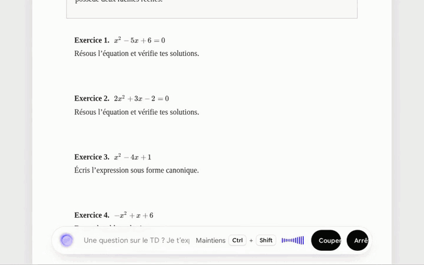
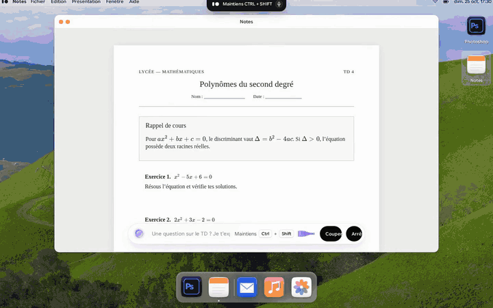
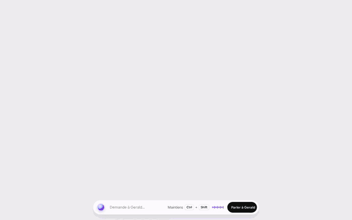
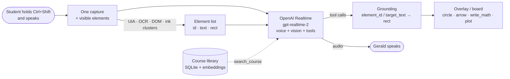
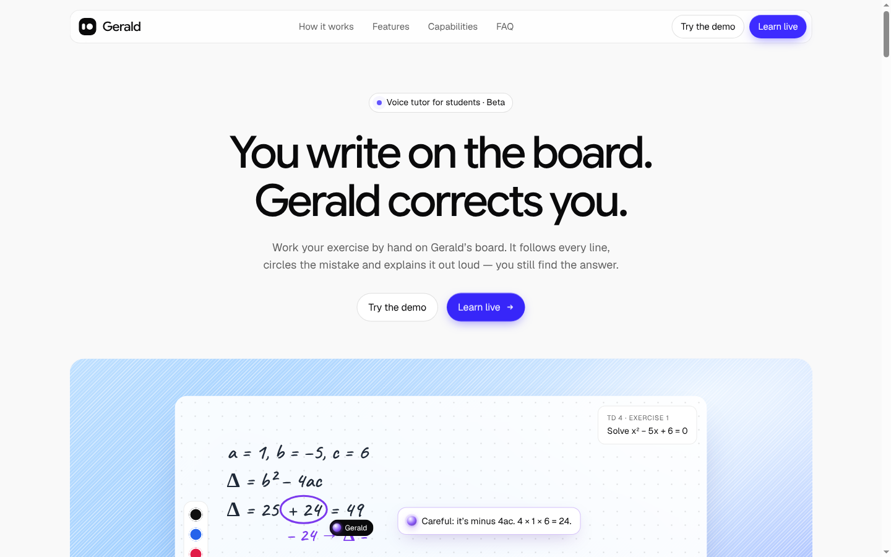

<div align="center">

# Gerald

**The AI tutor that lives on your screen.**
Hold <kbd>Ctrl</kbd> + <kbd>Shift</kbd>, ask out loud. Gerald looks at what you are working on,
answers by voice and draws on your screen — circles the mistake, writes the next step, plots the curve.
Then it lets *you* find the answer.

[](https://gerald-yl14.onrender.com/landing.html)
[](https://youtu.be/B41yHYg-4Sw)
[](https://www.tiktok.com/@intellectuelathlete/video/7700615552749931808)
[](https://gerald-pitch-deck.vercel.app/#1)
[](https://github.com/talal95c/Gerald.ai-)

**[Live demo](https://gerald-yl14.onrender.com/landing.html)** · **[Demo video](https://youtu.be/B41yHYg-4Sw)** · **[Build in public](https://www.tiktok.com/@intellectuelathlete/video/7700615552749931808)** · **[Pitch deck](https://gerald-pitch-deck.vercel.app/#1)** · [Architecture](docs/ARCHITECTURE.md) · [Run it locally](#quick-start)


<sub>Real recording of the web demo: the student writes Δ = 25 + 24, Gerald underlines « + 24 » and guides them to Δ = 1.</sub>

</div>

---

## Why

Everyone says « learn with AI ». In practice, before a student can even ask about a maths exercise,
they have to retype the equations or screenshot the page — and the chatbot answers with the full
solution. Nothing is learned. Private tutors fix this, but they are expensive and not there at 11 p.m.
(French 15-year-olds scored **474** in maths in PISA 2022, −21 points vs. 2018.)

Learning is written, drawn and pointed at. A tutor should be too.

## What Gerald does

| | |
|---|---|
| **Sees only when asked** | One screenshot per push-to-talk turn. No continuous capture, no recording at rest. |
| **Talks** | Low-latency voice in / voice out with OpenAI Realtime (`gpt-realtime-2`), conversation kept across turns. |
| **Draws where it matters** | Circle, underline, arrow, highlight, handwritten notes, LaTeX formulas, exact function plots — anchored to real on-screen elements, not guessed pixels. |
| **Teaches, not tells** | Tutor-first prompt: point at the error, give one step, ask the student to try. Measured with an LLM-judged pedagogy harness. |
| **Works on a whiteboard** | Write by hand (mouse, pen, iPad); Gerald reads your strokes, corrects in colour (red = correction, green = valid, blue = remark). |
| **Guides any app** | « How do I draw a red square in Photoshop? » → Gerald points at one control per step; *you* click. |
| **Knows your course** | Drop PDFs / docs into the companion app; Gerald searches them and cites them while tutoring. |

## Demo video

<div align="center">

[](https://youtu.be/B41yHYg-4Sw)

**[▶ Watch the demo video on YouTube](https://youtu.be/B41yHYg-4Sw)**

</div>

### Real recordings

Four real, unedited recordings of the live demo (click a GIF to open the full MP4 with sound).

| | |
|---|---|
| [](https://github.com/talal95c/Gerald.ai-/blob/main/pitch/media/04-board-correction.mp4)<br>**1. Correcting handwriting** — Gerald reads the student's Δ, underlines « + 24 » and guides to Δ = 1. <sub>18 s · [MP4](https://github.com/talal95c/Gerald.ai-/blob/main/pitch/media/04-board-correction.mp4)</sub> | [](https://github.com/talal95c/Gerald.ai-/blob/main/pitch/media/02-board-plot.mp4)<br>**2. Exact plots** — the parabola is drawn by the `plot` tool and its roots are marked. <sub>10 s · [MP4](https://github.com/talal95c/Gerald.ai-/blob/main/pitch/media/02-board-plot.mp4)</sub> |
| [](https://github.com/talal95c/Gerald.ai-/blob/main/pitch/media/01-desktop-notes.mp4)<br>**3. Reading the worksheet** — Gerald points at the exercise that matters. <sub>13 s · [MP4](https://github.com/talal95c/Gerald.ai-/blob/main/pitch/media/01-desktop-notes.mp4)</sub> | [](https://github.com/talal95c/Gerald.ai-/blob/main/pitch/media/03-photoshop.mp4)<br>**4. Guiding any software** — one control per step in a Photoshop-like editor, the student clicks. <sub>36 s · [MP4](https://github.com/talal95c/Gerald.ai-/blob/main/pitch/media/03-photoshop.mp4)</sub> |

> Want to see it think live? **[Open the demo](https://gerald-yl14.onrender.com/landing.html)** → *Try the demo* → hold <kbd>Ctrl</kbd> + <kbd>Shift</kbd> and ask.
> The making-of is on **[TikTok (build in public)](https://www.tiktok.com/@intellectuelathlete/video/7700615552749931808)**.

## Measured, not claimed

| What | Result | How |
|---|---|---|
| Pointing accuracy | **2.4 px** median error vs. **~90 px** for raw model coordinates (≈ 37×) | `scripts/eval_grounding.py` — targets grounded on UIA / OCR / DOM elements + Moondream point model |
| Grounding latency / cost | **~0.6 s** and **~$0.0002** per point (Moondream Cloud) | measured on 800×500 captures |
| Teaching quality | **77 % → 91–93 %** after the tutor-first prompt + cursor/diagram tools | `evals/pedagogy/` — real `gpt-realtime-2` turns on rendered scenarios, 8-criterion rubric judged by a reasoning model + deterministic checks |
| Test suite | 281 tests | `pytest` (Qt offscreen) |

## How it works



1. **Push-to-talk.** Holding the hotkey streams the mic and takes *one* screenshot of the monitor under the cursor.
2. **Perception.** Visible UI elements (Windows UI Automation, OCR, or the DOM in the web demo) and the student's ink clusters are sent alongside the image, each with an id, text and rectangle.
3. **Realtime brain.** `gpt-realtime-2` answers by voice and calls drawing tools. Tools target an `element_id` or a `target_text` (e.g. just « + 24 » inside a line), never raw coordinates.
4. **Grounding.** Targets resolve to exact rectangles; an optional point model (Moondream) handles what no element covers.
5. **Rendering.** A click-through, capture-excluded overlay (desktop) or the board / document layer (web) draws progressively under Gerald's animated cursor.

More detail: [docs/ARCHITECTURE.md](docs/ARCHITECTURE.md) · course library API: [docs/LIBRARY_API.md](docs/LIBRARY_API.md).

## Quick start

### Online, nothing to install

**[https://gerald-yl14.onrender.com/landing.html](https://gerald-yl14.onrender.com/landing.html)** — click **Try the demo**, open **Notes**, pick an exercise, hold <kbd>Ctrl</kbd> + <kbd>Shift</kbd> and talk (Chrome/Edge, microphone allowed). Hosted on Render's free plan: the first load can take ~30 s while the service wakes up.

### Web demo, locally (any OS, browser)

The fastest way to try Gerald: landing page → fake desktop → Notes (worksheet + board) and a Photoshop-like editor.

```bash
python3 -m venv .venv && . .venv/bin/activate
pip install -r requirements-web.txt
export OPENAI_API_KEY=sk-...
PYTHONPATH=. python scripts/web_voice_board.py --port 8765
```

Open **http://127.0.0.1:8765/** (use `127.0.0.1`, the server checks the `Host` header; add hosts with
`--public-host` or `GERALD_WEB_PUBLIC_HOSTS`). Click **Try the demo**, open **Notes**, pick an exercise,
then hold <kbd>Ctrl</kbd> + <kbd>Shift</kbd> and talk. The browser talks to OpenAI over WebRTC; the API key never leaves the server.



The built front-end is committed in `gerald/home/webui/`, so no Node.js is needed to run it.

### Desktop app (Windows first)

The full on-screen tutor: transparent overlay over *any* application, whiteboard, companion notch, course library.

```powershell
py -3.11 -m venv .venv
.\.venv\Scripts\Activate.ps1
python -m pip install -e ".[windows]"
Copy-Item .env.example .env   # then set OPENAI_API_KEY
gerald                         # or: python -m gerald
```

| Shortcut | Action |
|---|---|
| Hold <kbd>Ctrl</kbd>+<kbd>Shift</kbd> | Talk to Gerald (one capture for this turn) |
| <kbd>Ctrl</kbd>+<kbd>Shift</kbd>+<kbd>Enter</kbd> | Type a question instead |
| <kbd>Ctrl</kbd>+<kbd>Shift</kbd>+<kbd>B</kbd> | Open / close the whiteboard |
| <kbd>Ctrl</kbd>+<kbd>Shift</kbd>+<kbd>R</kbd> | End the session and save a revision sheet (Markdown, `~/Gerald/lessons/`) |
| <kbd>Esc</kbd> | Interrupt Gerald, cancel an action, clear drawings (release Ctrl+Shift first: Ctrl+Shift+Esc opens Task Manager) |

Linux and macOS start too; global hotkeys and element providers depend on what the OS exposes.

## Configuration

All settings live in `.env` (see [.env.example](.env.example)).

| Variable | Default | Purpose |
|---|---|---|
| `OPENAI_API_KEY` | — | Required. Realtime voice + vision. |
| `GERALD_MODEL` / `GERALD_VOICE` | `gpt-realtime-2` / `marin` | Realtime model and voice. |
| `GERALD_HOTKEY` | `ctrl+shift` | Push-to-talk chord. |
| `GERALD_MAX_IMAGE_W` | `1280` | Capture width sent to the model. |
| `GERALD_OCR_BUDGET` | `2.5` | Seconds allowed for OCR per turn. |
| `GERALD_REQUIRE_CONFIRMATION` | `1` | Ask « Allow / Cancel » before Gerald clicks or types (desktop). |
| `GERALD_GROUNDER` | `none` | Optional point model: `moondream-cloud` (`MOONDREAM_API_KEY`, free monthly credit), `moondream` (local CPU, `pip install -e ".[grounder-local]"`), `openrouter` (`OPENROUTER_API_KEY`). |
| `GERALD_MAX_SESSIONS_PER_CLIENT_HOUR` / `_PER_DAY` | `10` / `60` on Render | Web demo session caps to protect API credit (`0` = unlimited). |

No GPU? [`colab/gerald_grounder.ipynb`](colab/gerald_grounder.ipynb) serves the same `/v1/point` API from a free Colab T4
through a temporary Cloudflare tunnel: run all, then paste `MOONDREAM_ENDPOINT` / `MOONDREAM_API_KEY` into **Grounder…** in Gerald's menu.

## Privacy and safety

- **Vision only on demand**: a capture is taken when the hotkey is held (or a question is typed), never in the background. Proactive hints read only the foreground app name and window title, with no capture and no network call, until you accept.
- **Gerald never sees itself**: the overlay, notch and board are excluded from screen capture (`WDA_EXCLUDEFROMCAPTURE`) and click-through.
- **Guides, doesn't take over**: by default Gerald only points. Desktop clicks/typing require a real « Allow » click (the model's own `confirmed` flag is ignored), max 8 actions per turn, aborted by <kbd>Esc</kbd> or by moving the mouse.
- **Keys stay server-side** in the web demo; sessions are rate-limited.
- **Your course files stay local** (SQLite under `~/.gerald`).

## Repository layout

```
gerald/            Desktop app (Python 3.11, PyQt6)
  brain/           OpenAI Realtime session, turns, tool loop
  capture/         One-shot monitor capture, DPI handling
  perception/      UIA / OCR elements, grounding, Moondream / OpenRouter point models
  tools/           Tool schemas, plot & diagram renderers, revision sheet
  overlay/         Transparent click-through drawing layer, Gerald cursor and bubbles
  board.py         Whiteboard (pen / mouse ink kept separate from Gerald's ink)
  library/         Course library: ingest PDF/DOCX/MD, embeddings, search, Q&A
  home/            Companion notch (QWebEngine) + committed web build (webui/)
  prompts/         Tutor system prompt
web/               React + Vite sources: landing, fake desktop, worksheet (TD), board, notch
scripts/           Web voice server, grounding eval, screenshot/preview renderers
evals/             Grounding cases + pedagogy harness (scenarios, rubric, judge)
tests/             pytest suite
pitch/             Pitch deck (static HTML, open pitch/index.html)
video/             Remotion launch (~52 s) and pitch (~3:40) videos
colab/             Free-GPU fallback for the point model
render.yaml        One-click Render deploy of the web demo
```

## Development

```bash
pip install -e ".[dev]"
ruff check .
QT_QPA_PLATFORM=offscreen pytest -q
(cd web && npm ci && npm run build)   # rebuilds gerald/home/webui (committed)
```

Evaluations (need `OPENAI_API_KEY`):

```bash
python scripts/eval_grounding.py            # pointing accuracy (Playwright over CDP; --dry-gt needs no key)
python evals/pedagogy/run.py                # tutoring quality, LLM-judged; --only <scenario>
```

### Deploy the web demo

The public demo runs at [gerald-yl14.onrender.com](https://gerald-yl14.onrender.com/landing.html).

`render.yaml` deploys `scripts/web_voice_board.py` as a free Render web service (installs only
`requirements-web.txt`, health check on `/healthz`). In Render: **New → Blueprint**, pick this repo, set `OPENAI_API_KEY`.

## Pitch and videos

- **Pitch deck** — live at [gerald-pitch-deck.vercel.app](https://gerald-pitch-deck.vercel.app/#1); source in `pitch/index.html`, static, 1920×1080 stage with the demo clips in `pitch/media/`.
  Serve with `python3 -m http.server -d pitch` and press → to advance.
- **Demo video** — [YouTube](https://youtu.be/B41yHYg-4Sw).
- **Demo clips** — [`pitch/media/`](pitch/media/), shown above in [Demo video](#demo-video).
- **Build in public** — [TikTok](https://www.tiktok.com/@intellectuelathlete/video/7700615552749931808).
- **Videos** — Remotion compositions `Launch` and `Pitch` in [`video/`](video/README.md), English voice-over generated with OpenAI TTS.

## Credits

Built for a 2026 hackathon by [Talal Aamir](https://github.com/talal95c).
Uses OpenAI Realtime, [Moondream](https://moondream.ai) for point grounding,
[miniPaint](https://github.com/viliusle/miniPaint) (MIT) as the in-browser image editor,
[KaTeX](https://katex.org) for formulas, [pdf.js](https://mozilla.github.io/pdf.js/) for course PDFs,
and [Mixkit](https://mixkit.co/license/#musicFree) music in the videos.

## License

[MIT](LICENSE)
